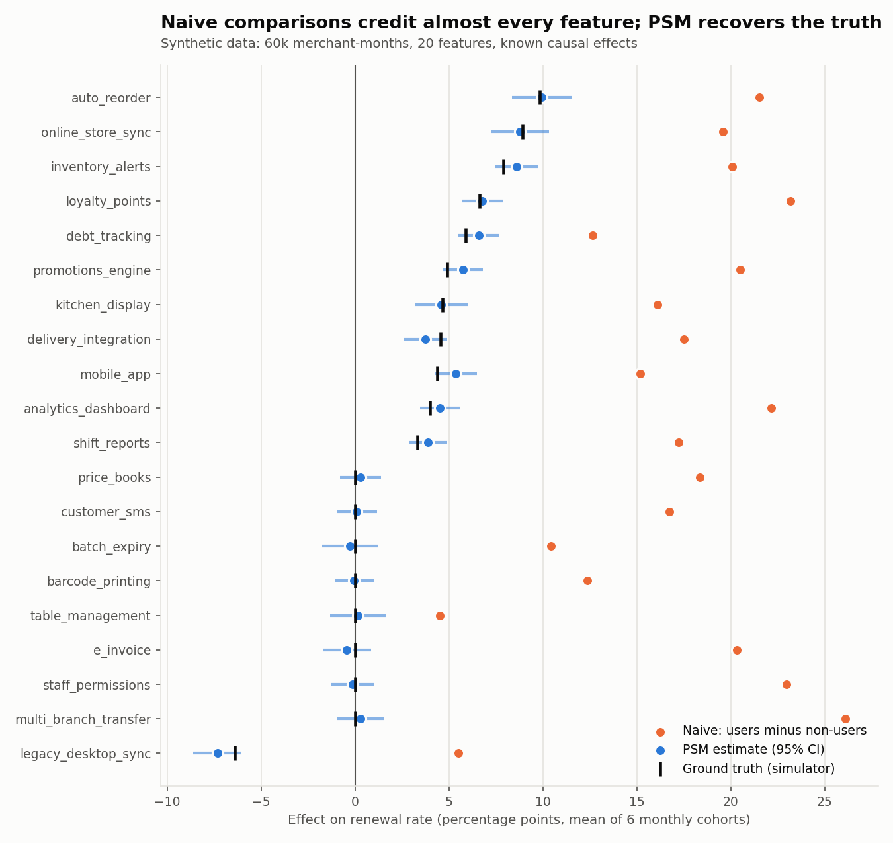
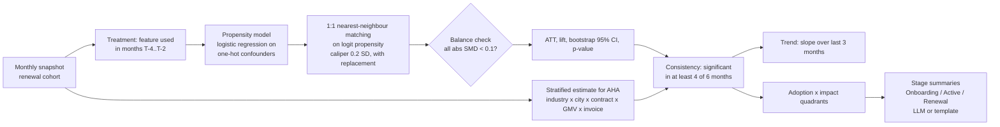
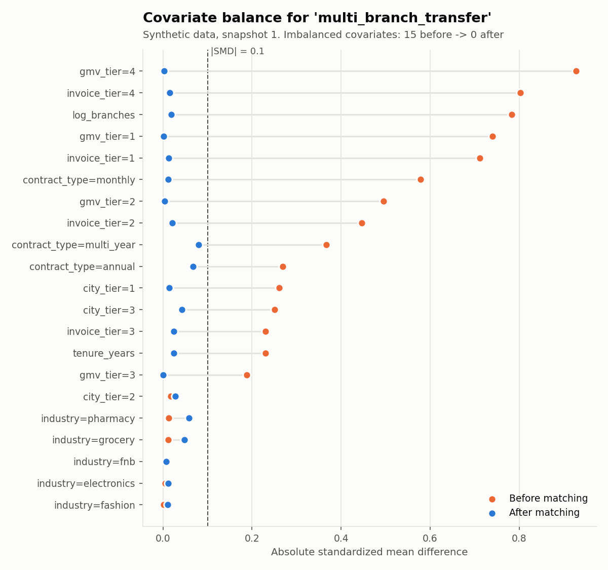
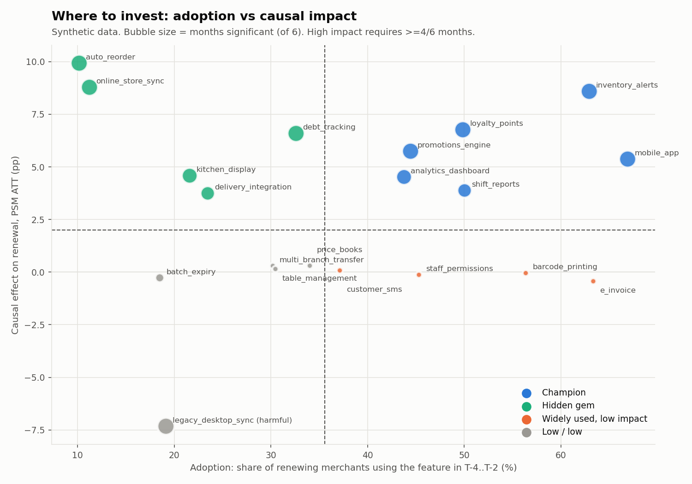

# Which features actually make merchants stay?

Causal feature impact with **propensity score matching (PSM)**, stratification and month-over-month
consistency checks, for a point-of-sale (POS) SaaS product.

> **Everything in this repository runs on synthetic data.** A seeded simulator generates the
> merchants, feature usage and outcomes, and because it knows the true causal effects, every estimate
> can be scored against the truth. No real customer data, code or numbers are included.



## 1. The business question

A POS SaaS product has ~50 features, and merchants renew their subscription yearly. Product and
Customer Success teams want to know:

1. **Renewal**: which features *cause* merchants to renew?
2. **AHA moment**: which features cause newly onboarded merchants to become long-term active users?
3. **Where to invest**: which high-impact features are still rarely used, so onboarding should push them?

## 2. Why the naive answer is wrong

The obvious analysis compares the renewal rate of users and non-users of each feature. It is
confounded: big chains (many branches, high GMV, long contracts) **use more features and also renew
more**, whatever features they use. In the synthetic benchmark the naive comparison:

* credits **every one of the 8 features with zero true effect** with a renewal lift of +4 to +26 pp,
  confirmed in at least 4 of 6 months,
* turns a feature that **lowers** renewal by 6 pp (`legacy_desktop_sync`) into an apparent +5 pp "driver",
* overstates real effects by roughly 2 to 4 times.

What we need instead is a comparison between users and non-users who are alike on the
confounders: same industry, city tier, contract type, GMV tier, invoice tier, number of branches
and tenure.

## 3. Method



| Step | Module | Key choices |
|---|---|---|
| Synthetic data | `feature_impact/synthetic.py` | 6 monthly cohorts x 10k merchants = 60k merchant-months; 7 confounders; 20 features with known logit-scale effects (11 positive, 8 zero, 1 negative; one rising and one fading over time). The true ATT is computed exactly from the outcome model. |
| PSM | `feature_impact/psm.py` | `LogisticRegression` on one-hot categorical plus standardized numeric confounders; 1:1 `NearestNeighbors` on the **logit** of the propensity; caliper **0.2 x SD(logit)** (Austin 2011), which adapts to how separable the groups are, while a fixed `caliper=0.05` is also supported; matching **with replacement** by default (lower bias, independent of matching order), with greedy matching without replacement as an option; guards `MIN_TREATED = MIN_CONTROL = 50`; SMD before/after with a flag when abs SMD > 0.1. |
| Inference | `feature_impact/psm.py` | Percentile CI from a **unit-level Poisson bootstrap**: each treated unit and each unique control gets its own weight, so a control that is reused k times moves k pairs together. A plain pair bootstrap ignores that reuse and covered only ~86% in testing. |
| Stratified ATE | `feature_impact/stratified.py` | Strata = industry x city_tier x contract_type x gmv_tier x invoice_tier, weighted by treated count; skips strata with < 5 rows, a missing arm, or zero variance in the control outcome; flags results as *not interpretable* when fewer than 3 strata survive or they cover < 50% of treated merchants. |
| Consistency | `feature_impact/consistency.py` | A feature is **confirmed** only if p < 0.05 with the same sign in at least 4 of 6 monthly cohorts. Trend = OLS slope over the last 3 months (rising / declining beyond ±1 pp per month; only labelled for confirmed features). |
| Quadrants | `feature_impact/quadrants.py` | Champion / Hidden gem / Widely used, low impact / Low-low. Adoption cut = median adoption; high impact = confirmed and ATT of at least +2 pp. A confirmed negative effect is flagged `harmful`. |
| Summaries | `feature_impact/summary.py` | Pydantic schema per lifecycle stage. `FEATURE_IMPACT_LLM=gemini\|openai` uses `instructor` (lazy imports). With no LLM configured, or on any failure, a deterministic template is used, so the pipeline runs offline. |

## 4. Results (synthetic data)

```bash
pip install -r requirements.txt
python -m feature_impact.cli run      # ~1.5 min; writes reports/ and docs/img/
pytest -q
```

Outputs: [`reports/feature_impact.csv`](reports/feature_impact.csv) (one row per feature),
[`reports/monthly_estimates.csv`](reports/monthly_estimates.csv),
[`reports/evaluation.csv`](reports/evaluation.csv), [`reports/summary.md`](reports/summary.md).

### Estimator accuracy vs ground truth (SYNTHETIC)

Each row pools 120 estimates (20 features x 6 monthly cohorts). Bias, MAE and RMSE are in percentage
points of the outcome rate. "Confirmed" uses the at-least-4-of-6-months rule.

| Outcome | Method | N | Bias (pp) | MAE (pp) | RMSE (pp) | 95% CI coverage | Null features confirmed | Real effects missed | Confirmed with wrong sign |
|---|---|---|---|---|---|---|---|---|---|
| renewed | Naive (users vs non-users) | 120 | 14.22 | 14.22 | 15.13 | - | 8 | 0 | 1 |
| renewed | PSM (1:1 NN, caliper 0.2 SD) | 120 | 0.13 | 1.08 | 1.29 | 98% | 0 | 0 | 0 |
| renewed | Stratified (skip zero-var strata) | 120 | 3.26 | 3.29 | 3.66 | 24% | 6 | 0 | 0 |
| renewed | Stratified (keep zero-var strata) | 120 | 0.64 | 1.06 | 1.29 | 87% | 0 | 0 | 0 |
| aha | Naive (users vs non-users) | 120 | 14.36 | 14.36 | 15.40 | - | 6 | 0 | 1 |
| aha | PSM (1:1 NN, caliper 0.2 SD) | 120 | -0.18 | 1.13 | 1.36 | 98% | 0 | 4 | 0 |
| aha | Stratified (skip zero-var strata) | 120 | 2.65 | 2.72 | 3.20 | 42% | 5 | 0 | 0 |
| aha | Stratified (keep zero-var strata) | 120 | 0.60 | 1.14 | 1.42 | 83% | 1 | 1 | 0 |

Takeaways:

* **Naive comparisons are badly biased** (+14 pp on average). They confirm every null feature
  and get the sign of the harmful feature wrong.
* **PSM is nearly unbiased** (bias of about 0.1 to 0.2 pp, RMSE about 1.3 pp). Its CIs are slightly
  conservative (98% coverage for a nominal 95%), and it never confirmed a null feature. The
  4 AHA "misses" are small true effects (+1 to +3 pp) that 10k-merchant cohorts cannot detect in
  4 of 6 months, so they are a power limit rather than a bias.
* **The stratified rule "skip strata with zero control variance" introduces upward bias.** It drops
  the cells where every control renewed, which are exactly the cells with small or negative lift.
  The result is about +3 pp of bias, poor CI coverage and 5 to 6 false confirmations. Keeping those
  strata (the last row) brings the bias down to about +0.6 pp; what remains comes from `branches`
  and `tenure`, which are not part of the strata. This is the main lesson of the rewrite: the skip
  rule protects against degenerate comparisons, but it should come with a bias check, and PSM
  should be the primary estimator.

### Covariate balance



`multi_branch_transfer` is the most confounded feature: chains use it, and chains renew. Before
matching, 15 covariate levels have abs SMD > 0.1, with GMV tier 4 at 0.9. After matching, all are
below 0.1. Every feature and month in the run reached max abs SMD < 0.1 after matching.

### Where to invest



* **Hidden gems** (`auto_reorder`, `online_store_sync`, `debt_tracking`, `kitchen_display`,
  `delivery_integration`) have large causal lifts but low adoption. They are the onboarding
  opportunity.
* **Widely used, low impact** (`e_invoice`, `barcode_printing`, `staff_permissions`, `customer_sms`)
  are popular, but popularity is not impact. They looked like top "drivers" in the naive view.
* `legacy_desktop_sync` is flagged **harmful**: its PSM ATT is about -7 pp in all 6 months.
* Trend labels pick up the simulated drift. `delivery_integration` is labelled rising and
  `analytics_dashboard` declining. There is one false "rising" label (`mobile_app`), a reminder that
  a 3-month slope is noisy.

The stage-by-stage summary is in [`reports/summary.md`](reports/summary.md). It is template-generated
by default; set `FEATURE_IMPACT_LLM=gemini` or `openai` and the matching API key to have an LLM
write it within the Pydantic schema.

## 5. Assumptions and limitations

* **Unconfoundedness**: matching only removes bias from *observed* confounders. Owner motivation,
  sales-rep quality or competitor pressure can affect both feature use and renewal. The simulator
  satisfies this assumption by construction; real data does not have to. A sensitivity analysis
  (e.g. Rosenbaum bounds or E-values) is the natural next step.
* **Overlap / positivity**: treated merchants with no control inside the caliper are dropped, which
  shifts the estimand to the matched treated population. `n_unmatched` is reported per run.
* **SUTVA**: one merchant's feature use must not affect another's outcome, and "used the feature"
  must mean a single version of the treatment. Multi-branch chains that share settings break this
  in part.
* **Timing**: the treatment window (T-4..T-2) ends before the renewal decision, so the outcome
  cannot cause the treatment. Merchants who already decided to churn may still reduce usage
  earlier, though, so some reverse causation can remain.
* **Stratified estimates**: strata where the control outcome is constant are skipped. A stratum with
  `outcome_control = 0` reports the treated rate itself as the "effect", which is **not causal**,
  and as the evaluation shows, skipping such strata biases the estimate upward. Results flagged
  `interpretable=False` describe only a subset of merchants.
* **Multiple testing**: 20 features x 6 months x 2 outcomes are tested. The at-least-4-of-6 rule
  works as a strict replication filter (P < 1e-4 for a null feature), but the per-month p-values
  are not adjusted.
* **Inference**: the bootstrap is conditional on the estimated propensity score and the match.

## Production version

The production version ran monthly on ~200k–670k merchant-month rows across two product verticals.
This repository is a clean-room rewrite on synthetic data. It reproduces the methodology
(PSM with balance checks, stratified AHA analysis, month-over-month confirmation, quadrants, LLM
stage summaries) and adds what production could not have: a ground truth to grade the estimators
against.

## Repository layout

```
feature_impact/
  synthetic.py     seeded data generator with known causal effects
  psm.py           propensity model, matching, ATT/lift/CI/p, SMD balance
  stratified.py    stratified ATE with skip rules and interpretability flag
  consistency.py   >=4-of-6-months confirmation and trend labels
  quadrants.py     adoption x impact classification
  summary.py       Pydantic stage summaries, LLM via instructor or template fallback
  pipeline.py      monthly run, feature table, evaluation vs ground truth
  plots.py         charts
  cli.py           python -m feature_impact.cli run
tests/             pytest: PSM recovery, balance, hand-computed stratified ATE, quadrants, ...
reports/           generated CSVs and summary.md (synthetic)
docs/img/          generated charts (synthetic)
```

## License

MIT, see [LICENSE](LICENSE).
